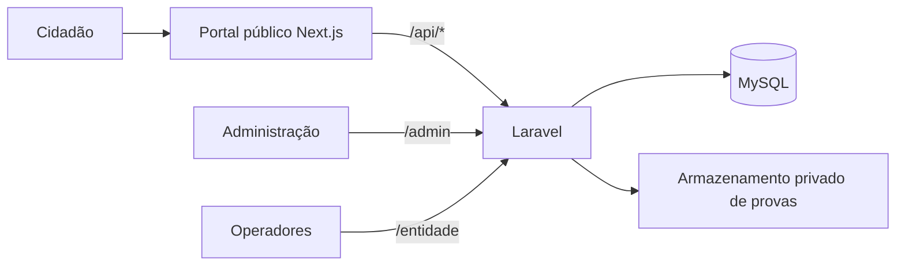

# Documentação técnica do Portal de Denúncias de Luanda

O portal recebe denúncias anónimas ou identificadas sobre ocorrências em Luanda. A Administração faz a triagem e encaminha cada denúncia para uma entidade. Os operadores da entidade publicam actualizações e podem concluir o tratamento. O cidadão acompanha a denúncia com a referência e o código secreto emitidos no registo.

## Arquitectura e organização do código



O portal público usa Next.js 16, React 19 e TypeScript 5. As páginas `/`, `/registar` e `/acompanhar` estão em [`frontend/app`](../frontend/app). O navegador faz pedidos ao mesmo domínio do portal. O servidor Next.js encaminha os quatro caminhos da API para o backend através de [`next.config.mjs`](../frontend/next.config.mjs).

O backend usa PHP 8.3 ou superior, Laravel 13 e Filament 5. Laravel disponibiliza a API pública e os dois painéis autenticados. MySQL é a base de referência e SQLite serve para demonstração local e testes. As versões instaladas são determinadas por [`composer.lock`](../backend/composer.lock) e [`package-lock.json`](../frontend/package-lock.json).

| Localização | Responsabilidade |
| --- | --- |
| [`backend/routes`](../backend/routes) | API pública, apresentação de provas, exportações e comandos Artisan. |
| [`backend/app/Providers`](../backend/app/Providers) e [`backend/app/Filament`](../backend/app/Filament) | Configuração dos painéis, páginas, recursos e acções internas. |
| [`ReportWorkflow.php`](../backend/app/Services/ReportWorkflow.php) | Validação e execução das transições da denúncia. |
| [`Reporting.php`](../backend/app/Services/Reporting.php) | Filtros, agregações e restrição dos relatórios à entidade autenticada. |
| [`backend/app/Models`](../backend/app/Models) e [`backend/database/migrations`](../backend/database/migrations) | Modelos Eloquent, esquema e dados iniciais dos catálogos. |
| [`app/model.php`](../app/model.php) e [`bin/demo.php`](../bin/demo.php) | Protótipo inicial em PHP e SQLite, com armazenamento próprio em `var/`. A demonstração da aplicação actual usa `php artisan portal:demo`. |

## Perfis e permissões

| Perfil | Acesso e operações |
| --- | --- |
| Cidadão | Regista sem conta. Consulta uma denúncia com a referência e o código secreto correspondentes. |
| Administrador (`admin`) | Entra em `/admin`. Consulta todas as denúncias, faz a triagem, encaminha, reencaminha, atribui operadores e arquiva. Gere entidades, operadores, administradores e catálogos. |
| Operador (`entity`) | Entra em `/entidade` com uma conta activa associada a uma entidade. Consulta os casos e relatórios da sua entidade e pode publicar actualizações e concluir os casos em tratamento. |

A associação de um caso a um operador identifica o responsável interno. A visibilidade e a autorização de tratamento no painel da entidade continuam a ser determinadas pelo `entity_id`. A suspensão de uma conta actualiza a versão da sessão. O middleware [`CheckPanelSession`](../backend/app/Http/Middleware/CheckPanelSession.php) invalida sessões suspensas ou com uma versão anterior.

## Ciclo de vida da denúncia

| Operação | Estado inicial | Resultado |
| --- | --- | --- |
| Registar | Novo registo | `Recebida`, com evento de recepção para triagem. O cidadão pode deixar a categoria por classificar. |
| Encaminhar | `Recebida` | `Em tratamento`. O administrador confirma uma categoria activa e selecciona uma entidade que recebe denúncias. |
| Atribuir operador | `Em tratamento`, sem operador | Mantém o estado. O administrador selecciona um operador activo da entidade responsável. |
| Reencaminhar | `Em tratamento` | Mantém o estado, troca a entidade e limpa a atribuição do operador. O histórico administrativo guarda a entidade anterior e o motivo. |
| Publicar actualização | `Em tratamento` | Mantém o estado e acrescenta uma mensagem visível ao cidadão. |
| Concluir | `Em tratamento` | `Concluída`, com a mensagem final do operador. |
| Arquivar | `Recebida`, `Em tratamento` ou `Concluída` | `Arquivada`. O motivo fica no histórico administrativo. |
| Classificar como falsa | `Recebida` ou `Em tratamento` | `Arquivada`. O cidadão vê a classificação e a Administração conserva o motivo. |

As opções de encaminhamento agrupam entidades do município da ocorrência, entidades de âmbito geral ou especializado e outras entidades disponíveis. A suspensão da recepção retira a entidade das opções para novos encaminhamentos. O serviço revalida o estado e a entidade na transacção e usa bloqueios de registos para operações concorrentes. As transições com histórico gravam o estado e o evento na mesma transacção.

## Modelo de dados

| Tabela | Campos e relações principais |
| --- | --- |
| `reports` | Referência única, hash do código, identificação e contacto opcionais, município, local, data da ocorrência, categoria opcional, descrição, estado e provas. `entity_id` referencia `entities` e `operator_id` referencia `users`. |
| `report_events` | Evento ligado a uma denúncia, com mensagem, data, autor interno quando aplicável e metadados de reencaminhamento, arquivo ou classificação. |
| `entities` | Nome único, âmbito, município opcional, contacto, morada e indicador de recepção `accepts_reports`. |
| `users` | Identidade, e-mail único, telefone, hash da palavra-passe, perfil, entidade opcional e dados de suspensão e sessão. |
| `categories` | Nome único, descrição da categoria e estado de disponibilidade. |
| `municipalities` | Nome único e estado de disponibilidade. `entities.municipality_id` referencia este catálogo. |

`reports.category` e `reports.municipality` guardam nomes em texto. No registo, a API valida os nomes contra os catálogos activos e grava a grafia do catálogo. O histórico público é devolvido pela ordem dos identificadores dos eventos. Os metadados administrativos ficam no painel da Administração. A validação da data da ocorrência e os filtros de dias dos relatórios usam a hora de Luanda (`Africa/Luanda`).

## API pública

As rotas estão em [`backend/routes/api.php`](../backend/routes/api.php). Para receber erros de validação em JSON, envie `Accept: application/json`. Use `Content-Type: application/json` nos pedidos sem ficheiros.

| Método e caminho | Resposta de sucesso |
| --- | --- |
| `GET /api/categories` | `200` com uma lista de nomes de categorias activas. Com `?details=1`, devolve objectos com `name` e `description`. |
| `GET /api/municipalities` | `200` com uma lista de nomes de municípios activos. |
| `POST /api/reports` | `201` com `reference` e `secret`. Limite configurado de 10 pedidos por minuto. |
| `POST /api/tracking` | `200` com `reference`, `status`, `description`, `classified_as_false` e `events`. Cada evento contém `message` e `created_at`. Limite configurado de 30 pedidos por minuto. |

### Registo

| Campo | Validação |
| --- | --- |
| `mode` | Obrigatório. Aceita `anonymous` ou `identified`. |
| `name` | Obrigatório no modo identificado, até 150 caracteres. Excluído no modo anónimo. |
| `phone` | Opcional no modo identificado. Aceita 9 dígitos ou `+` seguido de 8 a 15 dígitos, com primeiro dígito diferente de zero. A API remove espaços, parênteses e hífen antes de validar. |
| `municipality` | Obrigatório, até 100 caracteres. Deve corresponder a um município activo. |
| `category` | A chave é obrigatória. O valor pode ser `null` ou o nome de uma categoria activa, até 100 caracteres. |
| `occurred_on` | Opcional, no formato `AAAA-MM-DD` e até ao dia corrente em Luanda. |
| `location` | Obrigatório, até 200 caracteres. |
| `description` | Obrigatório, de 10 a 5000 caracteres. |
| `has_evidence` | Indicador opcional. Use `1` para declarar provas e `0` para assinalar a sua ausência. |
| `evidence_description` | Até 5000 caracteres. Com `has_evidence=1`, é preciso descrever as provas ou enviar pelo menos um ficheiro. |
| `evidence_files[]` | Partes `multipart/form-data` para até 3 ficheiros PDF, JPG, JPEG ou PNG, de até 2 MiB cada. Envie `has_evidence=1` no mesmo pedido. |

Exemplo local em PowerShell com dados fictícios e categoria por classificar. O segundo pedido reutiliza o recibo devolvido pelo primeiro.

```powershell
$base = 'http://127.0.0.1:8000'
$headers = @{ Accept = 'application/json' }
$registo = @{
    mode = 'anonymous'
    municipality = 'Ingombota'
    category = $null
    location = 'Local fictício para teste'
    description = 'Ocorrência fictícia para validar o registo.'
} | ConvertTo-Json

$recibo = Invoke-RestMethod -Uri "$base/api/reports" -Method Post `
    -Headers $headers -ContentType 'application/json; charset=utf-8' -Body $registo

$consulta = @{ reference = $recibo.reference; secret = $recibo.secret } | ConvertTo-Json
Invoke-RestMethod -Uri "$base/api/tracking" -Method Post `
    -Headers $headers -ContentType 'application/json' -Body $consulta
```

O registo devolve uma referência com prefixo `LD-` seguido de 12 caracteres hexadecimais e um código secreto de 20 caracteres hexadecimais. O backend guarda apenas o hash SHA-256 do código. A consulta recebe `reference` e `secret` no corpo do pedido, trata ambos sem distinção entre maiúsculas e minúsculas e devolve `404` se o par for inválido. Os `POST` devolvem `422` para dados inválidos e `429` quando atingem o limite. Uma carga acima do limite de processamento pode receber `413`. As respostas bem-sucedidas dos dois `POST` incluem `Cache-Control: no-store`.

## Provas e relatórios

Os anexos ficam em `backend/storage/app/private/report-evidence` no disco `local`. A base de dados guarda a lista de caminhos no campo `reports.evidence_files`. Em caso de falha no registo, a API tenta remover os ficheiros que já escreveu. A pré-visualização requer uma sessão no painel e respeita o âmbito da denúncia. A mesma restrição da entidade aplica-se ao descarregamento pelo painel. O acompanhamento público apresenta a descrição e as mensagens de estado, mantendo o nome, o telefone, as provas e os motivos administrativos dentro dos painéis autorizados.

Cada painel oferece `/relatorios`, com exportação em `/relatorios/exportar` para CSV e `/relatorios/exportar/pdf` para PDF. Combine o prefixo `/admin` ou `/entidade` com esses caminhos. Os parâmetros são `from` e `until` em `AAAA-MM-DD`, `group` com `municipality`, `category` ou `entity`, e os filtros opcionais `municipality`, `category` e `entity`. As datas referem-se ao dia de recepção da denúncia, com ambas as extremidades incluídas. O relatório agrega o estado actual dos registos no intervalo. No painel da entidade, o servidor restringe o filtro à entidade da sessão. O relatório administrativo inclui a contagem de denúncias classificadas como falsas entre as arquivadas.

## Instalação local

Use PHP 8.3 ou superior, Composer, Node.js 24 e npm. Active `intl`, `mbstring` e o controlador PDO da base escolhida. Use `pdo_mysql` para MySQL e `pdo_sqlite` para SQLite e para o teste de integração. `composer check-platform-reqs` verifica os requisitos das dependências instaladas.

Na raiz do repositório, prepare o backend em PowerShell.

```powershell
Set-Location backend
composer install
if (-not (Test-Path .env)) { Copy-Item .env.example .env }
```

Em `.env`, mantenha `APP_ENV=local` para a demonstração. Para MySQL, crie `portal_denuncias_bd` ou configure o nome da base existente em `DB_DATABASE`. Preencha `DB_HOST`, `DB_PORT`, `DB_USERNAME` e `DB_PASSWORD`. Para SQLite, use `DB_CONNECTION=sqlite`, retire a linha `DB_DATABASE` e crie `database/database.sqlite` vazio se o ficheiro ainda não existir.

Na primeira instalação, corra `php artisan key:generate` se `APP_KEY` estiver vazia. Depois aplique as migrações e inicie Laravel.

```powershell
php artisan migrate
php artisan portal:demo
php artisan serve --host=127.0.0.1 --port=8000
```

`portal:demo` funciona em `APP_ENV=local`. Cria `admin@portal.test`, `municipio@portal.test` e `servicos@portal.test` e mostra as palavras-passe iniciais das contas criadas naquela execução. Se já existirem contas com esses e-mails, o comando preserva-as.

Num segundo terminal, a partir da raiz, inicie o portal.

```powershell
Set-Location frontend
npm ci
npm run dev
```

Abra `http://localhost:3000` para o portal e `http://127.0.0.1:8000/admin` ou `http://127.0.0.1:8000/entidade` para os painéis. O destino padrão dos rewrites é `http://127.0.0.1:8000`. Defina `PORTAL_API_URL` antes de iniciar o ambiente de desenvolvimento ou gerar o build quando o endereço do Laravel for diferente.

### Cadastro de entidades de Luanda

Depois das migrações, `php artisan portal:cadastrar-entidades-luanda` cadastra as entidades municipais e especializadas em falta. Execute `php artisan portal:preencher-contactos-luanda` depois do cadastro para preencher campos vazios a partir de [`contactos_luanda.php`](../backend/database/data/contactos_luanda.php). O segundo comando procura as entidades pelo nome. Os dois comandos actuam na base configurada no backend.

## Operação e diagnóstico

Para alojar a aplicação, sirva `backend/public` como raiz web do Laravel e execute o Next.js com `npm run build` e `npm run start`. Configure o destino da API antes do build. A implantação requer um servidor PHP, um processo Node.js e a base de dados. Configure `APP_ENV=production`, `APP_DEBUG=false`, um `APP_URL` HTTPS e credenciais próprias do ambiente. Garanta escrita em `backend/storage` e `backend/bootstrap/cache`. As cópias de segurança precisam de abranger a base e o armazenamento privado das provas em conjunto.

Os limites de upload do PHP e do proxy precisam de acomodar os três anexos de 2 MiB e os restantes campos do pedido multipart. Confirme as permissões de leitura do armazenamento privado para a pré-visualização. A rota `GET /up` do Laravel serve para verificar se a aplicação arranca.

| Sintoma | Verificação |
| --- | --- |
| O formulário não carrega municípios ou categorias | Consulte `PORTAL_API_URL`, a disponibilidade do Laravel, as migrações e o estado activo dos catálogos. |
| O anexo falha com `413` | Verifique `upload_max_filesize`, `post_max_size` e o limite do corpo do pedido no proxy. |
| Uma entidade não aparece para encaminhamento | Consulte `accepts_reports` e, no reencaminhamento, a entidade responsável actual. |
| O operador perdeu acesso ao caso | Confirme o estado da conta, a entidade do operador e a entidade actualmente responsável pela denúncia. |
| A consulta devolve `404` | Confirme o par do comprovativo. O código secreto é entregue no registo e a base conserva o hash. |

## Verificação

Execute os comandos em terminais com as dependências instaladas, a partir da raiz do repositório.

```powershell
Set-Location backend
php tests/workflow.php
Set-Location ../frontend
npm run build
```

[`tests/workflow.php`](../backend/tests/workflow.php) executa as migrações em SQLite em memória e verifica, entre outros cenários, registo, consulta, triagem, isolamento entre entidades, reencaminhamento, suspensão de contas, exportações e provas. Usa um disco local simulado para anexos. `npm run build` compila o portal e verifica TypeScript.

Para validar o fluxo completo no navegador, registe uma ocorrência fictícia e guarde o comprovativo. Em `/admin`, encaminhe a denúncia para **Atendimento Municipal (demonstração)**. Entre em `/entidade` com `municipio@portal.test` e publique uma mensagem com a opção de conclusão. Em `/acompanhar`, confirme o estado `Concluída` e o histórico com os dados do comprovativo.
